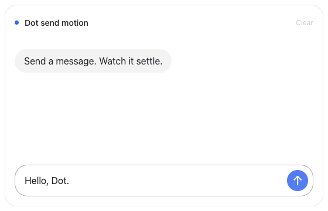

<h1 align="center">Codex Dot Send Motion</h1>

<p align="center">
  <strong>English</strong> · <a href="README.zh-CN.md">简体中文</a>
</p>

<p align="center">
  
  
  
</p>

<p align="center">A React message-send animation inspired by Codex Dot.</p>

<p align="center">
  
</p>

## Install with an agent

Paste this into your coding agent:

```text
Integrate https://github.com/wcqqq1214/codex-dot-send-motion into this app.
Follow docs/api.md and check React 19 + ESM compatibility.
Clone the library separately, use its pinned toolchain, run npm ci && npm pack,
and install the .tgz with the app's package manager.
Import 'codex-dot-send-motion/styles.css' and wire up captureSend as documented.
Verify typecheck, build, sending, and reduced motion.
```

[API & examples](docs/api.md) · [MIT](LICENSE)
